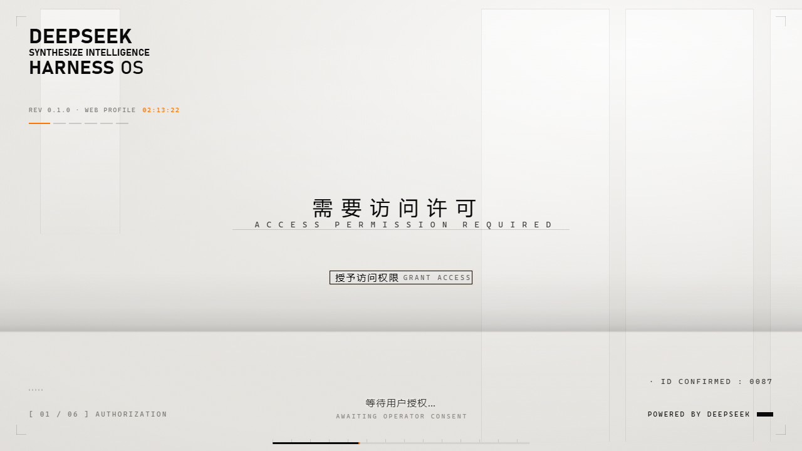
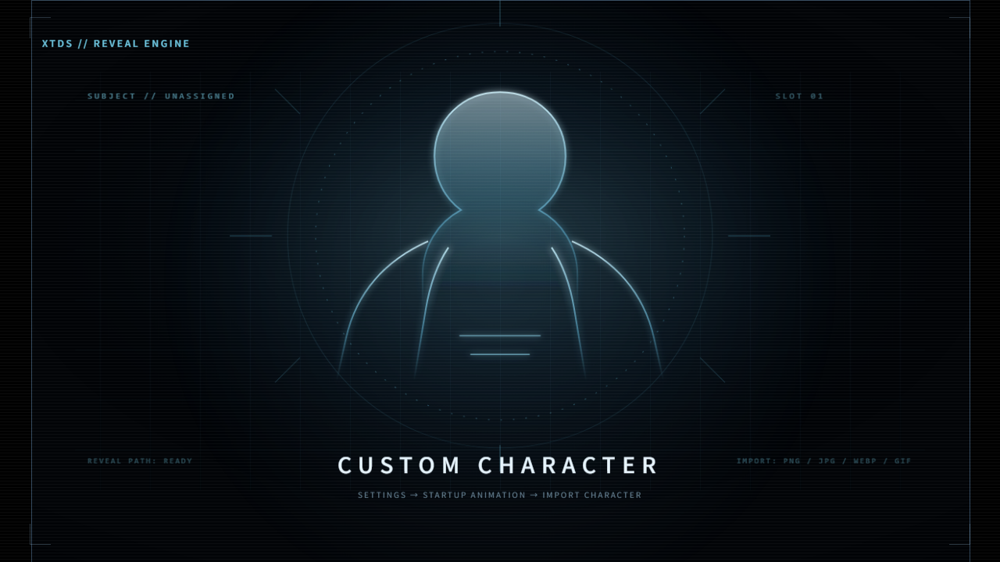
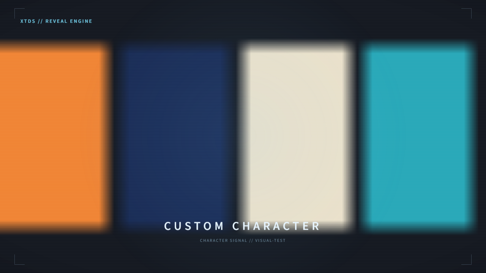
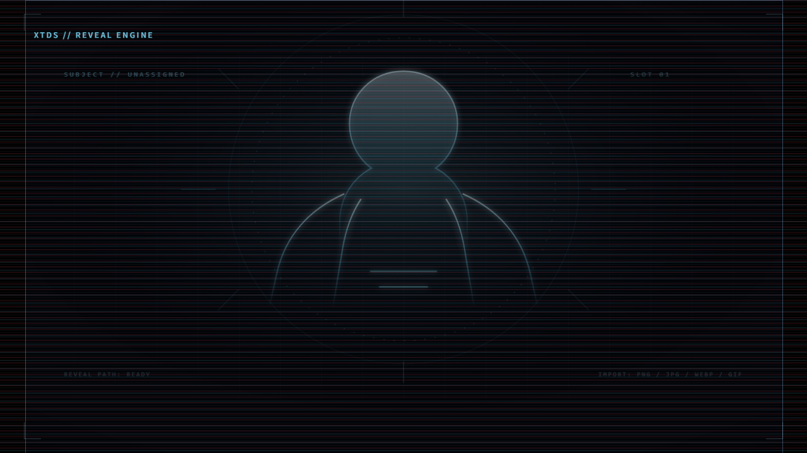

# xtds-start-dsh

> **XTDS custom build of the DSH startup suite.**
> By default it plays only the warm-white “technical dossier” opening.
> No dark character reveal is loaded unless you explicitly enable act two.
> The reveal engine is retained and can display an image you import.

This is an **XTDS fork**, not an official upstream release. It is based on
[LeeRolling/dsh-boot-suite](https://github.com/LeeRolling/dsh-boot-suite) at
`baec191` / `v2.16.11`. Package name: `xtds-start-dsh` (the old name
`xtds-boot-suite` is kept only for uninstall compatibility); version: `0.1.0`;
`private: true`. It is not published to npm or a public plugin store, but it
can be installed directly from this GitHub repository. A local-only index can
also expose it to DSH's Discover page for testing.

The original warm-white visual and narrative were created by **沈宏宏
(@6shenhonghong9)**. Upstream merging, fixes and maintenance are by
**LeeRolling**. XTDS only customizes the engineering and default behavior.
See [CREDITS.md](CREDITS.md) for full attribution and licensing.

## Install directly from GitHub (recommended)

DSH's plugin installer accepts a Git repository address. No npm package or
source archive is required.

1. Open the **Plugins** page in DeepSeek Harness.
2. Open the arrow next to **Add plugin** and choose **Install a third-party plugin**.
3. Paste:

   ```text
   https://github.com/XTrump-DSH-Ecosystem/xtds-start-dsh.git
   ```

4. Click **Install**, then **Enable now** when it finishes.
5. If DSH asks for a restart, fully quit and reopen it.

Notes:

- `private: true` only blocks `npm publish`; it does not block Git installs.
- DSH uses pnpm to clone the repository and read the root `package.json`.
- The machine must be able to reach GitHub; a proxy may be needed in mainland China.
- Git-installed plugins usually do not show the version-update section; uninstall and reinstall to upgrade.

## Alternative: local Discover index (testing)

This is not a public store: the helper starts a temporary index on
`127.0.0.1`, and nothing is uploaded.

1. Double-click **启动本地商城.cmd** in the repository root and keep the
   window open.
2. The browser opens a short guide and shows the local index URL. Click
   **复制地址** (Copy address).
3. Open the **Plugins** page in DeepSeek Harness.
4. On first use, enable **Custom plugin index** under **Experimental plugins**.
5. Return to Plugins, open **Discover**, click **Add index source** (or
   **Manage index sources…** in the toolbar), and paste the URL.
6. Find **XTDS Warm Archive Boot**, click **Install**, and confirm.
7. Close the local market window after installation.

Keep the window open while installing. If Discover is missing, confirm that
**Custom plugin index** is enabled, then refresh or restart DSH.

## Default behavior

- Act one is always normalized to `archive-warm`: a warm-white dossier plate
  with five access-authorization steps.
- Step 1 keeps the button / Enter / Space interaction and accepts a click as
  soon as the button appears. An early click switches to step 2 at the
  scanline's real end plus 100ms, without waiting for voice or an extra
  fade; a click after the scanline exits switches immediately. Step 2 shows
  the identity card automatically for 2 seconds, with no confirm button or
  key hint, plus a single light TV-style grid glitch.
- Automatic steps 3–5 stay on screen for at least one second in real time;
  the default holds are 1600ms, 1600ms, and 2000ms, and playback speed cannot
  reduce a single step below that floor.
- `act2` defaults to an empty string. No character reveal is loaded or shown
  during a normal startup.
- Old configurations that still reference removed upstream templates or an
  old `act2` are normalized back to the warm-white single act.
- Only two templates ship:
  - `templates/archive-warm`: the default opening.
  - `templates/xtds-character-reveal`: an optional, data-driven act-two slot.

Identity data is stored separately in `~/.dsh/dsh-startup-identity.json`
instead of being mixed into `~/.dsh/dsh-startup.json`. The public defaults
remain `JOYCE MOORE / 0087 / 3`; see
`config/dsh-startup-identity.example.json`. Keep personal identity data
local and out of the repository.

## Act two and custom character images

The act-two engine remains in `lib/splash.js`, including image/video layers,
timelines, keyframes, scanlines, CRT, glitch, HUD, bloom, vignette,
`playSecondTemplate()`, and safe fallback handling.

`xtds-character-reveal` contains only a generic XTDS placeholder line art.
It ships no ready-made character and is disabled by default.

### Import from Settings (no JSON editing)

1. Open **Settings → Startup Animation**.
2. Find **Act Two**.
3. Click **🖼️ Import Custom Character** and choose an image.
4. The plugin writes a local user template and selects act two automatically.
5. Click **Restore Built-in Placeholder** to return to the generic line art.

Accepted input:

- PNG / JPEG / WEBP / GIF;
- up to 20 MB;
- the host validates file magic bytes and rejects mismatched extensions;
- SVG is rejected;
- images stay in `~/.dsh/startup-templates/xtds-character-reveal/` on this machine.

If the imported image is missing or broken, the engine falls back to
`character-slot.svg`. The startup still finishes normally; it does not leave a
black screen.

## Preview

Double-click **打开预览.cmd**, or open `preview/index.html` directly.
`preview/demo.html` is a clean recording page without the control panel.
Offline preview does not write DSH configuration.









## Install

### Offline: Windows local install (link mode)

This fork does not use an upstream online installer and does not publish an npm
package. Use the GitHub address above when possible; if the local index or
GitHub is unavailable, install from the source checkout:

1. Obtain this repository or the XTDS local release archive.
2. Fully quit DeepSeek Harness Desktop, including the tray icon.
3. Double-click **安装.cmd**.
4. Reopen DSH manually.
5. The Settings page should expose “启动动画” and “聊天背景”.

See [INSTALL.md](INSTALL.md) for uninstall, rollback and diagnostics.

### Developer link install

Quit DSH first, then:

```powershell
dsh plugin --profile desktop add link:D:\path\to\xtds-start-dsh
```

> Replace `D:\path\to\xtds-start-dsh` with the actual checkout path. The folder
> name does not have to be `dsh-boot-suite`; the package name is `xtds-start-dsh`.

## Online update and template store

Both are fail-closed and disabled by default. The updater and store only become
available when `XTDS_UPDATE_REPO` or `DSH_STORE_URL` is explicitly configured.
The updater only accepts `xtds-start-dsh-win*.zip` assets.

## Tests

```powershell
npm test
node tools/motion-check.mjs --template=archive-warm --speed=3
node tools/motion-check.mjs --template=xtds-character-reveal --speed=2
node tools/visual-check.mjs --speed=3
```

Any test that touches DSH data must use a temporary `DSH_HOME` and clean it up.

## License and credits

- Code: MIT, inherited from upstream `LICENSE`; the file keeps the canonical
  MIT template so GitHub can detect it as MIT.
- See [NOTICE.md](NOTICE.md) for the original-work / derivative-work scope.
  `LICENSE` keeps both the 沈宏宏 and Xavier Trump copyright lines.
- Warm-white “technical dossier” visual and narrative: 沈宏宏
  (@6shenhonghong9), original project
  [dsh-startup-screen](https://github.com/6shenhonghong9/dsh-startup-screen).
- Upstream merge, fixes and maintenance: LeeRolling,
  [dsh-boot-suite](https://github.com/LeeRolling/dsh-boot-suite).
- XTDS engineering, placeholder line art and default warm-white wallpaper:
  also MIT with this fork.

The upstream whale-girl, big-fish, 550C and deep-sonar templates/assets have
been removed. Their history remains in the upstream repository's commits and
releases, not in this fork's current defaults.
