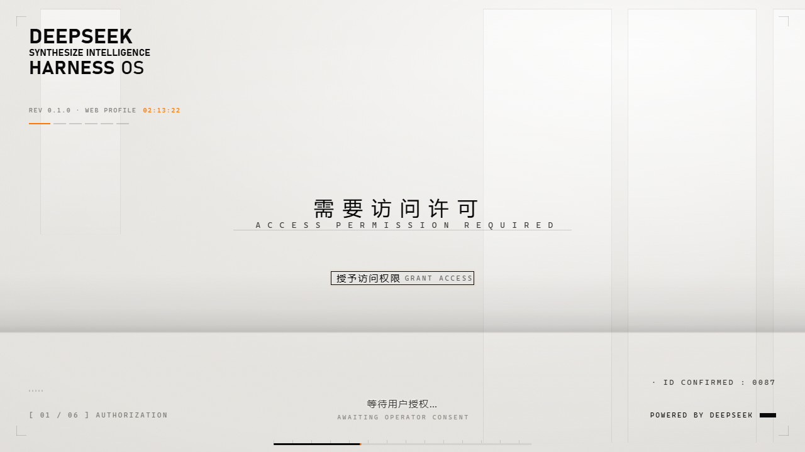
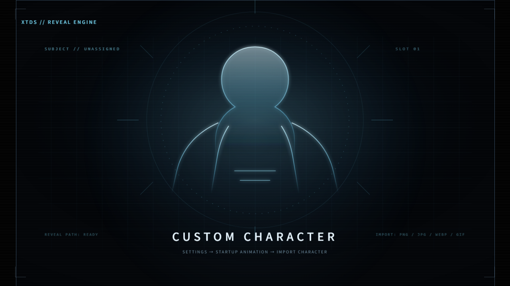
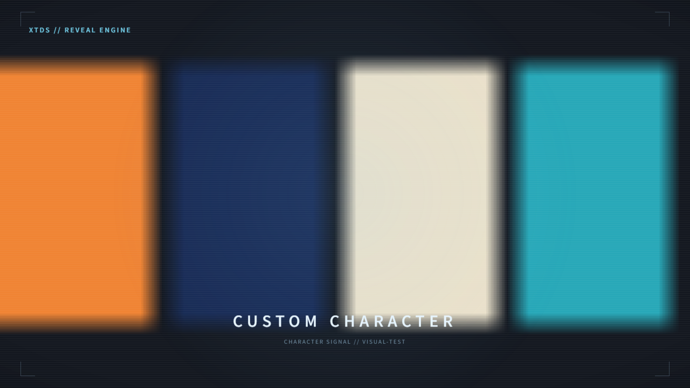
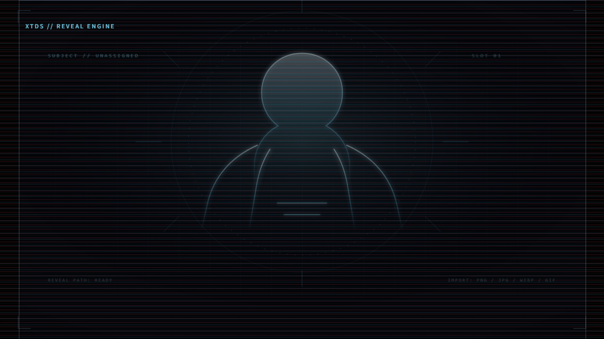

# xtds-start-dsh

> **XTDS 定制版 DSH 启动动画插件。**
> 默认只播放暖白「技术档案」序章；默认不播放黑暗中的角色揭示。
> 第二幕的揭示引擎完整保留，可以在设置页导入自己的形象。

这是一个基于 [LeeRolling/dsh-boot-suite](https://github.com/LeeRolling/dsh-boot-suite)
上游 `baec191` / `v2.16.11` 的 **XTDS 定制 fork**，不是上游官方版本。
包名 `xtds-start-dsh`（旧名 `xtds-boot-suite` 仅保留作卸载兼容），版本 `0.1.0`，`private: true`，不发布 npm，也不上架公开插件商店。
可以启动本机索引，在 DSH 的“插件 → 发现”里直接试装；本机商城不会把包上传到网络。

暖白片头的原始视觉与叙事作者是 **沈宏宏（@6shenhonghong9）**；
上游合并、修复与维护者是 **LeeRolling**。XTDS 只做工程结构与默认行为定制，
不主张这些原始视觉为 XTDS 原创。许可与完整署名见 [CREDITS.md](CREDITS.md)。

[](LICENSE)

## 插件商城试装（推荐先试）

这不是公开商店，也不会发布 npm 包。它只是在你自己的电脑上临时启动一个
`127.0.0.1` 索引，让 DSH 的“发现”页能够识别并安装本插件。

1. 双击本仓库根目录的 **启动本地商城.cmd**，保持窗口打开。
2. 浏览器会打开操作说明页，并显示本机索引地址；点 **复制地址**。
3. 打开 DeepSeek Harness 的 **插件** 页。
4. 首次使用时，在 **实验性插件** 中启用 **自定义插件索引**。
5. 回到插件页，打开 **发现**，点 **添加索引源**（或工具栏的 **管理索引源…**），
   粘贴刚复制的地址并确认。
6. 在列表中找到 **XTDS 暖白启动动画**，点 **安装**，按提示确认。
7. 安装完成后可以关闭本机商城窗口。以后要重装时再双击启动即可。

安装期间不要关闭商城窗口；如果看不到“发现”，确认“自定义插件索引”已启用，
然后刷新插件页或重启 DSH 再试。

## 默认行为

- 第一幕固定回落为 `archive-warm`：暖白技术档案底板 + 五步访问授权。
- 第 1 步保留按钮 / Enter / 空格交互，按钮一出现就能点击；如果点得早，
  画面会在扫描线真正结束后 100ms 才切到第 2 步，不会被语音或额外淡出拖住；
  扫描线结束后再点则直接切页。第 2 步身份卡自动停留 2 秒，
  不再显示“确认身份”按钮或按键提示，并带一次轻量电视方格花屏。
- 第 3、4、5 步自动播放时每幕至少停留 1 秒；默认模板的停留分别为
  1600ms、1600ms、2000ms，播放倍速不会把单幕压到 1 秒以下。
- 配置中的 `act2` 默认为空，**启动时不会加载或显示第二幕**。
- 旧配置如果还引用已删除的上游模板或旧 `act2`，会自动归一化为暖白单幕。
- 只内置两个模板：
  - `templates/archive-warm`：默认暖白序章。
  - `templates/xtds-character-reveal`：默认关闭的数据驱动第二幕空槽位。

身份资料单独保存在 `~/.dsh/dsh-startup-identity.json`，不再混在
`~/.dsh/dsh-startup.json` 里。公开默认值仍是原来的
`JOYCE MOORE / 0087 / 3`；示例文件见
`config/dsh-startup-identity.example.json`。自己的身份资料只写本机，不要提交到仓库。

## 第二幕：保留的揭示引擎

第二幕没有被删除。`lib/splash.js` 仍支持：

- 图片或视频图层；
- 时间轴与关键帧；
- 扫描线、CRT、故障、HUD、泛光和暗角；
- `playSecondTemplate()` 与失败回退。

`xtds-character-reveal` 只含 XTDS 自制的通用占位线稿，不含任何现成角色。
它默认不启用，适合以后替换成你自己的新形象。

### 导入自己的形象（推荐，无需手改 JSON）

安装插件并打开 DSH 后：

1. 进入 **设置 → 启动动画**。
2. 找到 **第二幕**。
3. 点击 **🖼️ 导入自定义形象**，选择图片。
4. 导入成功后会生成本机用户模板，并自动选中第二幕。
5. 想回到占位线稿时，点击 **恢复内置占位**。

支持格式与限制：

- PNG / JPEG / WEBP / GIF；
- 单张最大 20MB；
- 宿主会校验图片魔数（文件头），扩展名和内容不一致会被拒绝；
- **不接收 SVG**；
- 图片只写入本机 `~/.dsh/startup-templates/xtds-character-reveal/`，不上传。

导入图片缺失或损坏时，引擎会回退到 `character-slot.svg`，启动动画仍会正常结束，不会黑屏。

## 预览

不想安装也能先看画面：

1. 双击根目录的 **打开预览.cmd**；或直接打开 `preview/index.html`。
2. `preview/demo.html` 是无控制台的纯净演示页，适合截图和录屏。
3. 预览页默认读取 `archive-warm` + `act2: ''`，不会自动出现角色揭示。

离线预览不会写入 DSH 配置。设置面板里的导入按钮只是界面演示；
真正导入形象需要安装插件后在 DSH 设置页操作。

### 截图证据



默认启动：暖白档案序列，没有第二幕。



明确启用第二幕后：通用占位线稿和揭示 HUD。



通过导入路由写入临时 DSH_HOME 的四色测试图。



删除图片后自动回退占位，不黑屏。

## 其他安装方式

### 备用：Windows 本地安装（link 方式）

本 fork 不提供上游在线安装地址，也不发布 npm 包。本机商城不可用时，可以改用
源码目录的 link 安装：

1. 取得本仓库或 XTDS 本地发布包。
2. **完全退出** DeepSeek Harness Desktop（窗口和托盘都要退出）。
3. 双击根目录的 **安装.cmd**。
4. 安装完成后手动重新打开 DSH。
5. 设置页应出现「启动动画」和「聊天背景」。

安装脚本会处理旧插件名残留，并生成本地回滚入口。
更完整的安装、卸载、回滚和排错步骤见 [INSTALL.md](INSTALL.md)。

### 开发者：link 安装

先完全退出 DSH，然后：

```powershell
dsh plugin --profile desktop add link:D:\path\to\dsh-boot-suite
```

> 把 `D:\path\to\dsh-boot-suite` 换成本仓库的实际绝对路径；目录名不必叫
> `dsh-boot-suite`。包名以 `package.json` 的 `xtds-start-dsh` 为准。

桌面端 profile 在运行时会锁定 `package.json`，不要边运行边写 profile。

## 功能范围

- **启动动画**：默认暖白单幕；保留可选第二幕、转场、音效、语音、自定义动画和本机音乐。
- **聊天背景**：XTDS 暖白默认壁纸；仍支持本机静态图、循环视频、横幅和纱的浓度。
- **模板编辑器**：`tools/editor.html` 可离线打开；模板仍是纯数据。
- **在线更新与模板商店**：默认关闭。只有显式设置 `XTDS_UPDATE_REPO` / `DSH_STORE_URL`
  才会启用；更新资产只接受 `xtds-start-dsh-win*.zip`。

## 测试与验证

```powershell
npm test
node tools/motion-check.mjs --template=archive-warm --speed=3
node tools/motion-check.mjs --template=xtds-character-reveal --speed=2
node tools/visual-check.mjs --speed=3
```

所有会触碰 DSH 目录的测试必须使用临时 `DSH_HOME`，结束后清理。
视觉验收会生成/更新 `docs/evidence/` 下的截图；不要用旧上游截图代表当前默认画面。

## 目录

```text
lib/                         宿主与浏览器运行时、暖白壁纸
templates/archive-warm/      默认暖白序章
templates/xtds-character-reveal/  可选第二幕空槽位
preview/                     离线预览页
test/                        smoke 测试
tools/                       安装、回滚、预览、视觉与动效检查
docs/evidence/               当前视觉验收截图
```

## 许可与署名

- 代码：MIT，沿用上游 `LICENSE`。
- 暖白「技术档案」视觉与叙事：沈宏宏（@6shenhonghong9），原作
  [dsh-startup-screen](https://github.com/6shenhonghong9/dsh-startup-screen)。
- 上游合并、修复与维护：LeeRolling，
  [dsh-boot-suite](https://github.com/LeeRolling/dsh-boot-suite)。
- XTDS 新增的工程代码、占位线稿与暖白默认壁纸：同样按 MIT 随本 fork 提供。
- 用户导入的图片/视频：版权归用户或原权利人，仅保存在本机。

上游历史版本中的鲸鱼娘、全景大肥鱼、550C、深海声呐等模板和素材已从本 fork 删除。
相关历史只保留在 [CHANGELOG.md](CHANGELOG.md) 的上游版本记录中，不代表当前默认内容。
